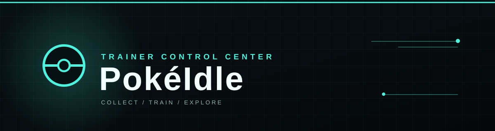

  

<h1 align="center">🎮 PokéIdle</h1>

<strong>探索地區・收集寶可夢・打造你的最強隊伍</strong>

一款在瀏覽器中遊玩的寶可夢放置收集遊戲。

本作品修改自 [jinwind1/pokemon-idle](https://github.com/jinwind1/pokemon-idle)，原專案作者為 **jinwind**。此版本已修改遊戲介面、功能與資料，並非原作者發布的原版。

---

## 🚀 開始冒險

**線上遊玩：** [https://qq7-git.github.io/pokeidle/](https://qq7-git.github.io/pokeidle/)

下載專案後，以瀏覽器開啟 **`index.html`** 即可遊玩，無須安裝套件或建置。首次進入時可查看遊戲指引與免責聲明。

選擇道路，自動戰鬥、收集寶可夢並解鎖地區。部分功能需要完成圖鑑。

## 🎮 遊戲系統

| 系統 | 玩法 |
| :--- | :--- |
| ⚔️ **自動戰鬥** | 探索道路、獲取經驗與金幣，並可依敵人選擇適合的隊員出戰。 |
| 📖 **寶可夢圖鑑** | 搜尋、篩選與管理收集成果，追求閃光與 6V 個體。 |
| 🏅 **徽章與寶石** | 完成地區圖鑑取得徽章，鑲嵌與合成寶石強化隊伍。 |
| 🌱 **樹果花園** | 種植、採收與餵食樹果，提升寶可夢的種族值。 |
| ⚡ **技能與天賦** | 屬性技能等級全存檔共享；Lv.1000 可升級並重置等級，雙屬性每次選一種技能升級。其他同屬性寶可夢達 Lv.500 後可使用共享技能；親自升級者有「⚡技能」標記且免門檻。戰鬥按實際傷害選招，雙屬性技能全解鎖時不列入普通攻擊。 |
| 🗼 **極限對戰塔** | 挑戰高難度樓層，以歷史通關層數提升經驗、金幣與閃光機率。 |
| 🎯 **自由狩獵場** | 完成 Mega 圖鑑後，自選六隻寶可夢狩獵 6V 與閃光。 |

## 🌙 離線進度

符合條件的離線時間會在返回遊戲時結算；一般道路固定以離開前所在道路計算，可結算時長依遊戲進度與徽章效果而定。

> 不同瀏覽器、裝置與網址各自保存遊戲進度；線上版本不會自動同步本機存檔。

## 💾 存檔與備份

進度保存在目前瀏覽器的本機儲存空間。更換瀏覽器或裝置、清除瀏覽器資料之前，請到 **設定 → 存檔管理** 匯出備份。

> [!IMPORTANT]
> 匯入存檔會取代目前進度，請先備份。存檔雖經壓縮與編碼，**並未加密**，請妥善保存，不要公開分享。

## 📄 原始專案與授權

基於原版 V2.70 修改，日期：2026-10-27。

本專案基於 [GNU Affero General Public License v3.0](LICENSE)（AGPL-3.0）開源，完整授權條款見 `LICENSE`。提供本程式給其他人或讓他們透過網路使用修改版時，須依授權條款提供對應原始碼並保留相關聲明。

### 第三方程式庫

- [lz-string](https://github.com/pieroxy/lz-string) **1.5.0**：用於壓縮存檔資料及相容舊版存檔；作者為 pieroxy，採用 [MIT 授權](docs/lz-string-LICENSE.txt)。壓縮不等於加密。

## ⚠️ 免責聲明

- 本遊戲由 AI 協助修改，僅供學習交流與技術展示，不用於商業用途。
- 「寶可夢／Pokémon」及相關角色、名稱與圖像的權利歸原權利人所有。
- 如有侵權或不當使用，請聯繫修改或移除。

---

Modified with ❤️ by <strong>QQ7</strong> Thanks to the original creator <strong>jinwind</strong>

